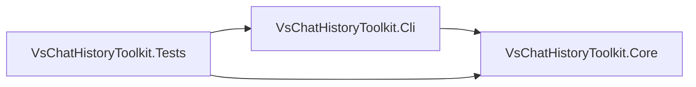

# Code Summary

VsChatHistoryToolkit is a .NET 8 library and `chathistory` CLI for read-only search and inspection of Visual Studio Copilot Chat history in the local `session-store.db`, with safe session renaming as the only write operation. The solution uses Microsoft.Data.Sqlite and includes xUnit tests backed by generated fixtures.

| Project | Symbol | File | Responsibility |
| --- | --- | --- | --- |
| Core | `ChatStore` | `src/VsChatHistoryToolkit.Core/ChatStore.cs` | Read-only queries over sessions, turns, checkpoints, usage, events and files; numeric-only latest-turn usage snapshots. |
| Core | `UsageTurnsResult` / `UsageTurnSnapshot` | `src/VsChatHistoryToolkit.Core/Results.cs` | Latest usage-bearing indices, numeric totals and per-turn UTC usage-event endpoints, without chat metadata. |
| Core | `StoreConnection` | `src/VsChatHistoryToolkit.Core/StoreConnection.cs` | Opens the SQLite store and validates its schema. |
| Core | `SessionRenamer` | `src/VsChatHistoryToolkit.Core/SessionRenamer.cs` | Renames and undoes renames for a selected session. |
| Core | `ActivityProbe` | `src/VsChatHistoryToolkit.Core/ActivityProbe.cs` | Summarizes activity from stored usage data. |
| Core | `EventsSummaryScanner` | `src/VsChatHistoryToolkit.Core/EventsSummaryScanner.cs` | Bounded scan of event logs for summary metadata. |
| CLI | `Program` | `src/VsChatHistoryToolkit.Cli/Program.cs` | Configures UTF-8 output and starts the CLI runner. |
| CLI | `CliRunner` | `src/VsChatHistoryToolkit.Cli/CliRunner.cs` | Parses and dispatches commands, returning JSON or text results. |
| CLI | `TextFormatter` | `src/VsChatHistoryToolkit.Cli/TextFormatter.cs` | Formats and cleans human-readable output. |
| Tests | `VsChatHistoryToolkit.Tests` | `tests/VsChatHistoryToolkit.Tests` | Exercises core and CLI behavior using synthetic data. |

See `docs/KEY_FLOWS.md` for traced end-to-end call flows.
